# Light Sheet 3D Scanner

A 3D scanner built from a camera and a laser light sheet, written from scratch in Python with NumPy and OpenCV. It calibrates the camera, calibrates the light plane, and measures the profile of 3D-printed solids in millimetres, with every step tested and validated against the drawings of the solids and against synthetic data with a known answer.

[](pyproject.toml)
[](LICENSE)

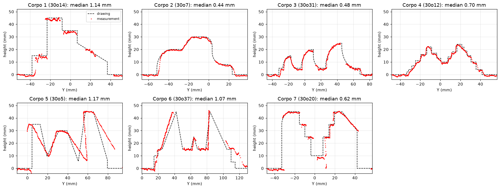

*One held-out scan per solid. Plot labels are in Italian.*

Final project of the *3D Vision Systems* course (University of Brescia, 2024/25), rewritten as a package with a command line, unit tests, regressions on the real images and executed notebooks.

## Results

The lab images have a heavily distorted lens and a setup that moved during the session, so the numbers below are those of that setup, measured honestly.

Fourteen of the 33 scans match one of the six solids whose drawings I have ([data/scans.csv](data/scans.csv)). Two of them (a Corpo 5 and a Corpo 6) are the ones I used to choose and tune the algorithms, so their error is optimistic: they are marked `dev`. The other twelve, covering all six solids, had no part in any choice and are the real test.

| Scans | Median distance of the points from the drawing | Peak heights (measured − nominal) |
|---|---|---|
| 12 held-out `test` scans | **0.91 mm** on average, 1.54 mm at worst | −0.15 mm on average, 0.75 mm rms |
| same, allowing a skewed placement (below) | **0.79 mm** on average, 1.31 mm at worst | |
| 2 `dev` scans | 0.58 mm | −0.33 mm on average, 0.58 mm rms |

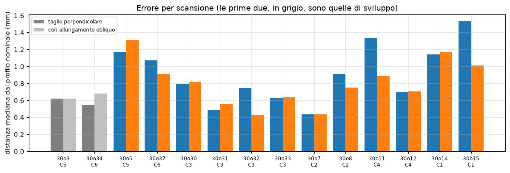

| Solid | Scans | Median distance | with skewed placement |
|---|---|---|---|
| Corpo 1 (stairs and slope) | 2 | 1.34 mm | 1.07 mm |
| Corpo 2 (arcs) | 2 | 0.67 mm | 0.60 mm |
| Corpo 3 (arcs) | 4 | 0.66 mm | 0.58 mm |
| Corpo 4 (staircase) | 2 | 1.01 mm | 0.79 mm |
| Corpo 5 | 2 (1 `dev`) | 0.90 mm | 0.96 mm |
| Corpo 6 | 2 (1 `dev`) | 0.81 mm | 0.74 mm |

Other calibration figures: the light plane has 0.51 mm rms error on held-out points, and the camera 1.6 px median reprojection residual (3.6 px rms; 9 wrong centres out of 1028 are discarded).

> [!NOTE]
> How far to trust these numbers:
> - **The solids were recognised automatically.** For each scan I took the nominal profile with the smallest distance and kept those below 1.6 mm with at least 150 points on the solid, which biases the error low. The other 19 scans match none of the six profiles (probably the seventh solid, which has a bore, or poses outside the measuring plane) and are not used.
> - **The drawings are the ground truth, and the solids are 3D printed.** FDM parts deviate from their drawing by about 0.2–0.3 mm on their own.
> - **A skewed placement is a real effect.** A solid laid across the sheet is cut obliquely and its profile is stretched along Y by 1/cos(angle). With `oblique=True` the nominal profile may stretch, and the stretch found is always reported. For the scans where the solid is aligned with the sheet it comes out at 1.00, which is an independent check that the Y scale of the calibration (the 20 mm pitch of the master) is right within about 1%; for the others it is 1.07–1.33, a tilt of 20–40 degrees. It gets worse on one scan (`30o5`), where the pose is more complex than a rotation.
> - **Some features cannot be measured.** Flanks that are too steep are not lit by the sheet and seen by the camera, so they leave gaps.

### What limits the accuracy

Four measurements on the real data, the first three reproduced in [notebook 6](notebooks/06_heldout_validation.ipynb):

- **The lens is heavily distorted, but it is not what limits the scans.** It displaces the corners of the image by up to 270 px, and the radial model with two coefficients brings the median reprojection residual to 1.6 px. The sheet, however, falls near the middle of the image (columns 1100–1250 of 2130), where the displacement is at most about 40 px at the two ends of the line, so the residual distortion hardly touches the measurement. A second acquisition session (1818×1212, similar distortion, corners displaced by up to 230 px) calibrates with the same code through its own `dataset.toml`, with four views and 4.7 px rms; it has no drawings, so it is not used for the results.
- **The triangulation is weak.** The sheet moves only 0.79 px for each mm of height, so one pixel of error on the sheet is **1.27 mm** of height. The 0.9 mm error on the test scans corresponds to about 0.7 px: the result is close to what this laser and camera geometry allows, not to a limit of the code.
- **The setup moved during the session.** The line of the sheet on the support plane sits at −0.05 px of the calibration in the first scans and at up to −1.75 px in the last ones, about 2 mm. The levelling of each scan removes a pure shift, but it shows that the camera, the laser or the plane were not still.

  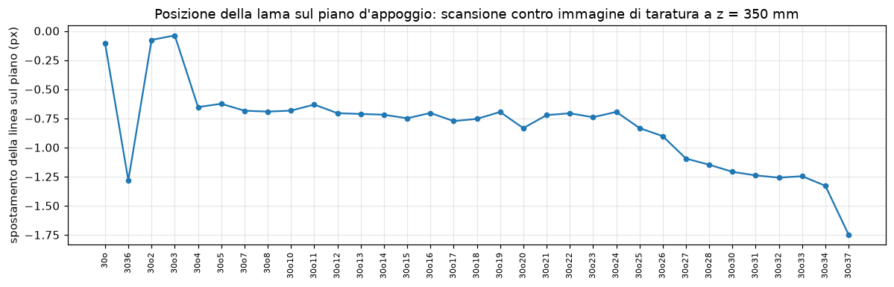

- **The calibration is fragile to single views.** Leaving out one view of the master moves the peak heights by up to 4.5 mm on the real data and by 0.1 mm on synthetic data (see below), so the real views are not consistent with each other. This is a property of the images, not of the algorithm.

What did not help on the held-out scans: dropping the inconsistent views (330 and 340 mm), correcting the height of each view with the end views held fixed, and the other attempts listed in [Tried and not adopted](#tried-and-not-adopted).

## Quick start

Requires [uv](https://docs.astral.sh/uv/) and Python 3.12 or later (developed on 3.15).

```bash
uv sync
uv run pytest        # about 2 minutes: synthetic end-to-end tests and regressions on the real images
```

Calibrate a dataset once, then measure as many scans as you want:

```bash
uv run lightsheet3d calibrate data/dataset.toml -o calibration.json
uv run lightsheet3d scan calibration.json data/scans/30o34.jpg --solid corpo6 --ply corpo6.ply
uv run lightsheet3d evaluate data/dataset.toml --calibration calibration.json --csv results.csv
```

```text
data/scans/30o34.jpg: 1390 points
  peak 1: y =  -29.9 mm  height  44.4 mm  flanks l/r  61.6° /   nan°
  peak 2: y =   -7.4 mm  height  24.1 mm  flanks l/r  71.9° /  61.2°
  peak 3: y =   11.7 mm  height  44.6 mm  flanks l/r  82.8° /  54.8°
  comparison with Corpo 6: median distance 0.55 mm, 90th percentile 1.52 mm (563 points on the solid)
```

`evaluate` measures every scan listed in the manifest and prints the error per scan, per role (`dev`/`test`) and per solid. Both `scan` and `evaluate` accept `--oblique`. `calibrate --extractor steger` uses Steger's method (stored in the calibration file and reused by `scan`). `lightsheet3d synthetic DIR --noise 0.5` writes a synthetic dataset, with its own `dataset.toml` and manifest, so the same commands run on data with a known answer.

The same from Python:

```python
from lightsheet3d.dataset import Dataset
from lightsheet3d.scanner import Calibration, Scanner
from lightsheet3d.solids import SOLIDS

dataset = Dataset.load("data/dataset.toml")
calibration = Calibration.fit(dataset)        # .report says how the fit went; .save("calibration.json")

profile = Scanner(calibration).scan("data/scans/30o34.jpg")
for peak in profile.peaks():
    print(f"peak at y = {peak.y:6.1f} mm, height {peak.height:4.1f} mm")

comparison = profile.compare(SOLIDS["corpo6"])  # oblique=True lets the nominal profile stretch
print(comparison.median, comparison.height_errors)
profile.to_ply("corpo6.ply", comparison)         # x, y, height, coloured by distance from the drawing
```

The notebooks open with the project kernel (`ipykernel` is a dev dependency), for example from VS Code. JupyterLab is not included: `pyyaml` has no wheel for Python 3.15 yet.

### Using your own images

A dataset is a folder with the master images at known heights, the sheet on the master at the same heights, and the scans, described by a `dataset.toml` ([the one for `data/`](data/dataset.toml)):

```toml
image_size = [2130, 1420]
pitch_mm = 20.0                 # distance between the circles of the master
pattern_max = [21, 14]          # largest grid searched, columns and rows
z_scale = 10.0                  # z (mm) = first two digits of the file name * z_scale + z_offset
z_offset = 50.0                 # so 26.jpg and 26l.jpg are the master at z = 310 mm
reference_z = 350.0             # the reference view of the master
plate_z = 350.0                 # the plane the solids rest on
target_dir = "camera_calibration"
sheet_dir = "light_plane_calibration"
scans_dir = "scans"
manifest = "scans.csv"          # optional: file,solid,role of the scans with a known solid
```

The master is a grid of circles with three larger ones in an "L" (the corner is the origin; the arms point toward increasing columns and rows, 3 and 2 pitches long here). The pitch cannot be recovered from the images: scaling x and y by a constant is absorbed exactly by the projection matrix, so it only sets the scale in millimetres of Y. The 1.00 found for the aligned scans (see above) is the only independent check of the 20 mm.

## How it works

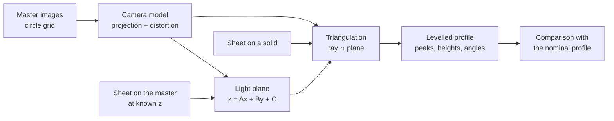

| 1. Camera | 2. Sheet centroid | 3. Light plane |
|---|---|---|
| 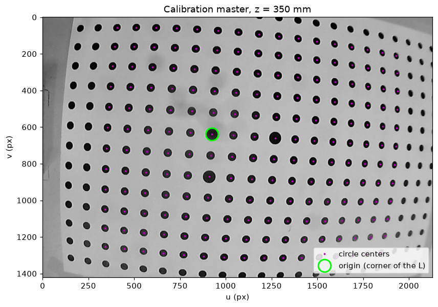 | 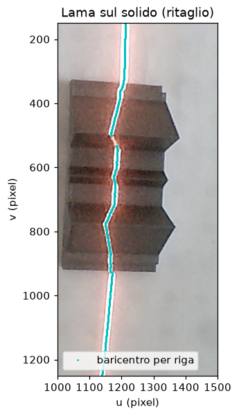 |  |
| The master is a grid of circles with three larger ones in an "L"; the corner is the origin. | The centroid of the sheet is taken on every image row. | The plane is fitted on the calibration points and validated on held-out ones. |

1. **Camera** ([notebook 1](notebooks/01_camera_calibration.ipynb)). One model (projection matrix, radial distortion and the master's lateral shift for each view) is fitted by least squares on all views, after discarding the wrong centres. It works on points, not images, so distortion is never corrected twice.
2. **Light sheet** ([notebook 2](notebooks/02_light_plane_calibration.ipynb)). Each centroid is brought to object space by intersecting its ray with the plane at known `z`; the plane `z = Ax + By + C` is fitted by least squares and validated on held-out points and views.
3. **Measurement** ([notebook 3](notebooks/03_measurements.ipynb)). Every sheet pixel on a solid is triangulated with the camera and the plane; the profile is levelled on the support plane and peaks, heights and flank angles are extracted.

<details>
<summary>Camera calibration residuals</summary>

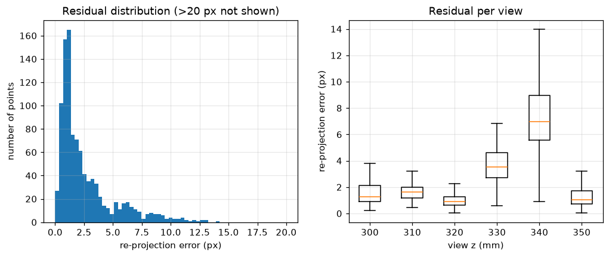

</details>

### 3D curve and point export

Each scan is the 3D curve where the sheet meets the solid. It lies on the plane of the sheet, so it is not a full 3D scan (that would need the solid or the sheet to move). The figure shows it over the nominal profile, with each point coloured by its distance from it.

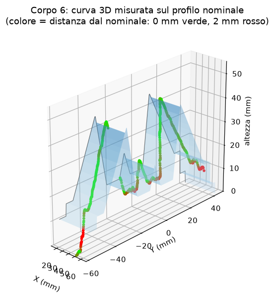

[docs/examples/corpo6_scan.ply](docs/examples/corpo6_scan.ply) holds the same points and colours (x, y and height in mm), and opens in MeshLab, CloudCompare or Open3D.

## Nominal profiles

`lightsheet3d.solids` holds the profile of each solid. They are read from the technical drawings: the front view is a filled vector path in the PDF, which `pdftocairo` converts to SVG, so the vertices (arcs included) are exact; [scripts/extract_drawing_profiles.py](scripts/extract_drawing_profiles.py) regenerates [profiles.json](src/lightsheet3d/profiles.json) from a folder of the PDFs. The profiles of Corpo 5 and Corpo 6, first built by hand from the dimensions, agree with the extracted ones within 0.03 mm, and the tests check it. Corpo 7, which has a stepped bore, is not included.

The scan frame is arbitrary, so `align` finds the shift and direction that put the nominal profile best on the measured points, and `distances` measures each point's distance to it in the (y, h) plane, which does not inflate errors on steep flanks.

> [!IMPORTANT]
> The assignment text and the drawings of the solids are course material (S. Dello Iacono, D. Solinas) and belong to their authors; they are not in this repository. The profiles are only their dimensions.

## Validation on synthetic data

Real images have no ground truth, so the measured error mixes the algorithm and the setup. `lightsheet3d.synthetic` renders images of a known scene (camera parameters taken from the real calibration, circle master, light sheet, a solid with its nominal profile) with the same names and format as the real ones; the pipeline reads them unchanged and the result is compared with the true geometry.


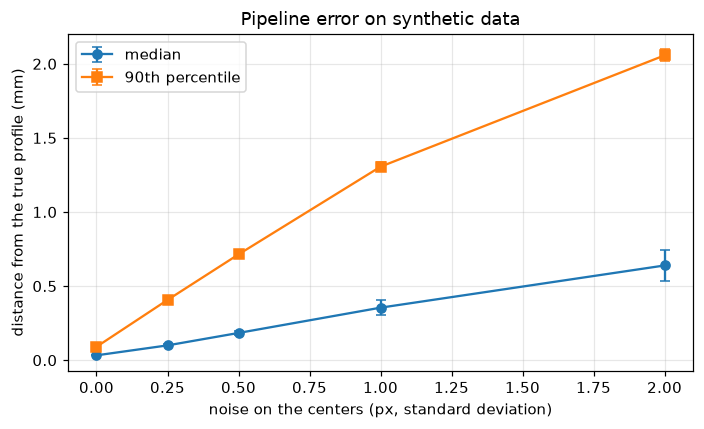

| Noise on the centres | Median distance from the true profile | 90th percentile |
|---|---|---|
| 0 px | 0.03 mm | 0.09 mm |
| 0.5 px | 0.18 mm | 0.74 mm |
| 1 px | 0.35 mm | 1.24 mm |
| 2 px | 0.64 mm | 1.98 mm |

The real error (0.9 mm median on the test scans) is higher than the 0.64 mm of 2 px of noise, and I have not measured the real noise directly. With 2 px of noise the sheet produces spurious peaks of up to 10 mm on the support plane, so `measure_peaks` needs `prominence=10` instead of 6.

The synthetic data found four defects, each now covered by a test that fails without the fix:

- **Master drift in the camera fit.** The fit invented a linear drift of the master along z even when it did not move (a 0.25 mm systematic error with no noise). A linear drift in the offsets is indistinguishable from a small tilt of the axis in the projection matrix, so `fit_camera` now removes it.
- **Peak heights.** Sharp peaks were underestimated by about 0.5 mm, because the sheet has a thickness and the per-row centroid cuts the tip. `measure_peaks` now takes the intersection of the two flank lines, and the median of the points on a wide flat top. Over 8 seeds the bias goes from −0.52 mm to 0.00 mm without noise and from −0.44 mm to −0.01 mm at 0.5 px, with the same or lower rms.
- **Centroid of the sheet.** It used only the saturated core, with half a pixel of resolution; it is now weighted by the intensity on the soft edges (median error without noise from 0.10 to 0.03 mm).
- **Blob detector and profile alignment.** OpenCV's blob detector rejects circles above 5000 px², which dropped the large circles of the "L" when the master was close; and `align` could pick the mirrored profile with 2 px of noise because the vertical error was almost tied. It now decides with the distance in the (y, h) plane. The grid orientation is also fixed from the arms of the "L", since `findCirclesGrid` cannot tell a symmetric grid from its 180° rotation.

### Sheet extraction: centroid or Steger

The default finds the sheet with an intensity-weighted centroid on the saturated core. `--extractor steger` (or `laser_steger`) refines the position with Steger's ridge detection along the normal of the line, inside the same saturated region, so it finds the same rows. With a blurred sheet and noise on the intensities it halves the error; on the real images it does not help, so the centroid stays the default and Steger, 11 times slower, is an option.

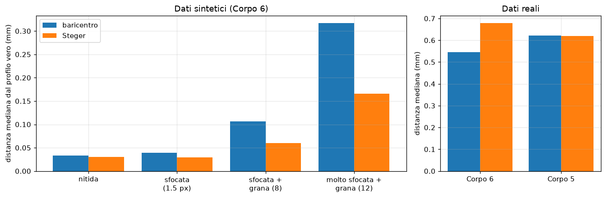

| Synthetic, Corpo 6 | Centroid | Steger |
|---|---|---|
| sharp | 0.032 mm | 0.030 mm |
| blurred 1.5 px + noise 8 | 0.111 mm | 0.063 mm |
| blurred 2.5 px + noise 12 | 0.328 mm | 0.171 mm |
| **Real, Corpo 6 / Corpo 5** | 0.546 / 0.624 mm | 0.679 / 0.619 mm |

The real sheet is wide (about 18 px of saturated core) and well contrasted, which is where the centroid is already accurate, and the real error is dominated by the calibration, not by the extraction. Two details matter for Steger: its scale `sigma` has to be at least width / (2√3), so it is derived from the width of the saturated core, and near the end of an interrupted line the normal rotates and the position can jump by several pixels, so it falls back to the centroid when the ridge is more than 1 px away from it. A version that took its candidates from a response threshold instead of the saturated core lost a quarter of the rows on the real images and broke on noisy synthetic ones.

## Sensitivity to the calibration

With six views of the master there is no classical error estimate. [Notebook 5](notebooks/05_uncertainty.ipynb) recalibrates leaving out one view at a time (the view is dropped from both the camera and the light plane) and measures how much the result moves, on the real data and on synthetic data with the same geometry.

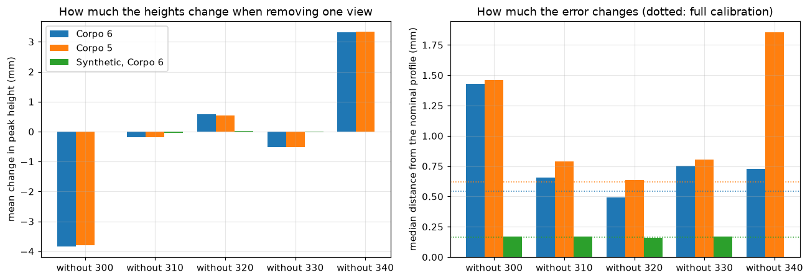

| Left out | Corpo 6 peak heights | Median distance Corpo 6 / Corpo 5 |
|---|---|---|
| none | 44.4 / 24.1 / 44.6 mm | 0.55 / 0.62 mm |
| z = 300 | 39.9 / 21.5 / 40.1 mm | 1.43 / 1.45 mm |
| z = 340 | 48.2 / 26.3 / 48.5 mm | 0.73 / 1.85 mm |

On synthetic data no single view moves the heights by more than 0.1 mm, so the sensitivity comes from the setup, not from the algorithm. The analysis also found a defect: leaving out the view at z = 320 mm halved the camera rms. That view had 9 wrong centres, all in the last column of the master next to the image edge, with residuals of about 67 px (81% of the sum of squared residuals). `calibrate_camera` now discards points whose residual is more than 10 times the median and refits (rms from 7.3 to 3.6 px).

## Tried and not adopted

Each of these was measured against the synthetic data, the sensitivity analysis and, later, the held-out scans before deciding.

- **Dropping the inconsistent views.** Without the views at 330 and 340 mm the camera fits better, but the median distance on the 12 test scans goes from 0.91 to 1.08 mm; without 340 alone to 1.53 mm, and without 300 to 1.68 mm. Every view helps.
- **Correcting the height of each view.** Estimating a height error per view, with the 300 and 350 mm views held fixed (and the same correction used for the light plane), brings the camera rms from 3.6 to 2.0 px, and leaves the test error at 0.91 mm (1.01 mm when the correction is also applied to the plane). Holding only the reference view fixed and applying the correction to the plane gives 0.84 mm, which is within the noise of the result.
- **Joint estimate of camera and light plane** ([experiments/joint_calibration.py](experiments/joint_calibration.py)). The two calibration steps are merged, so the sheet also constrains the projection matrix. On synthetic data it is indistinguishable from the two-step estimate (median distance 0.344 against 0.352 mm at 1 px of noise, 0.646 against 0.642 mm at 2 px). On the real data it improves Corpo 6 (0.55 to 0.47 mm) and worsens Corpo 5 (0.62 to 0.91 mm), and leaves the dependence on single views almost unchanged. It adds parameters and a weight between pixels and millimetres for no demonstrable gain.
- **A richer pose of the master in each view** (a height error and a rotation, besides the lateral shift). The residuals of every view fall to about 1 px, but the profile error on the real scans rose from about 0.5 to 0.8 mm. The code was not kept.
- **More radial distortion coefficients.** With three, Corpo 6 improves (0.53 to 0.38 mm) and Corpo 5 worsens (0.69 to 0.74 mm); with four it worsens further. Two are kept.
- **Steger's method as the default** (see above): better on blurred, noisy synthetic images, no gain on the real ones.

## Project layout

```
src/lightsheet3d/
  dataset.py      dataset.toml: folders, naming and geometry conventions, scan manifest
  scanner.py      Calibration, Scanner, Profile, Comparison: the entry point
  evaluate.py     error on every scan of the manifest, by role and by solid
  cli.py          the `lightsheet3d` command (calibrate, scan, evaluate, synthetic)
  pipeline.py     from raw images to calibration and points
  grid.py         circle grid, origin and orientation (the "L")
  calibration.py  normalised DLT, radial distortion, joint model, wrong-centre rejection
  laser.py        sheet extraction: weighted centroid and Steger
  lightplane.py   light plane and triangulation
  measure.py      profile levelling, peak heights and flank angles
  solids.py       nominal profiles (profiles.json), alignment, distance to the measured profile
  uncertainty.py  leave-one-view-out sensitivity of the result to the calibration
  synthetic.py    synthetic datasets with known geometry
  export.py       PLY export of the measured points
  report.py       plots
scripts/          regenerates the nominal profiles from the drawing PDFs
tests/            unit tests, synthetic end-to-end tests and regressions on the real images
experiments/      experiments that were measured and not adopted
notebooks/        six notebooks with saved outputs
data/             the lab images, dataset.toml and the scan manifest
docs/             figures and an example point cloud
```

<details>
<summary>Italiano</summary>

Scanner 3D a triangolazione con telecamera e lama di luce, scritto da zero in Python con NumPy e OpenCV: calibrazione della camera, calibrazione del piano laser e misura in millimetri del profilo di solidi stampati in 3D. Progetto finale del corso *Sistemi di Visione 3D* (Università degli Studi di Brescia, A.A. 2024/25), riscritto come pacchetto testato con una CLI.

- **Risultati onesti**: 14 delle 33 scansioni corrispondono a uno dei sei solidi di cui ho il disegno. Due (Corpo 5 e Corpo 6) hanno guidato le scelte di algoritmo e sono ottimistiche (0,58 mm); le altre 12, su tutti e sei i solidi, sono il vero test: distanza mediana dal disegno **0,91 mm** (0,79 mm se si ammette un solido posato di traverso rispetto alla lama).
- **Cosa limita la precisione**: la triangolazione è debole (0,79 px per mm di quota, quindi 1 px = 1,27 mm; l'errore sui test vale circa 0,7 px); il banco si è mosso durante l'acquisizione (la linea sul piano si sposta fino a circa 2 mm); la calibrazione è fragile alle singole viste (fino a 4,5 mm sui dati reali, 0,1 mm su quelli sintetici).
- **Validazione sintetica**: un generatore di immagini con geometria nota ha trovato difetti reali (deriva degli offset, altezza dei picchi sottostimata di 0,5 mm, baricentro della lama, rilevamento dei cerchi grandi, allineamento specchiato), tutti corretti e coperti da test.
- **Uso**: `uv sync`; `uv run lightsheet3d calibrate data/dataset.toml`, poi `scan` e `evaluate`. Un dataset si descrive con un `dataset.toml` (cartelle, passo del master, quote dai nomi dei file).
- **Tentativi non adottati**: togliere le viste incoerenti, correggere la quota di ogni vista, calibrazione congiunta, più coefficienti radiali: nessuno migliora l'errore sulle scansioni di test.
- La traccia e i disegni dei solidi sono materiale del corso (S. Dello Iacono, D. Solinas) e non sono inclusi; i profili nominali ne sono solo le quote.

</details>
