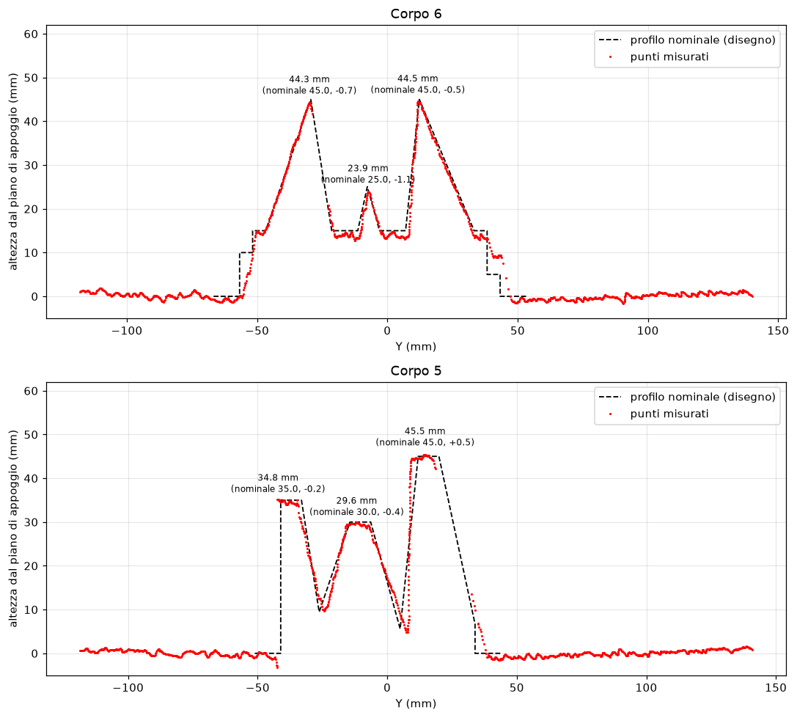
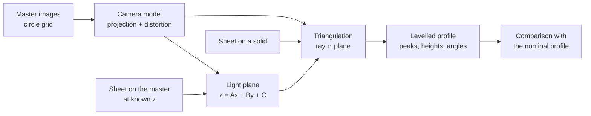
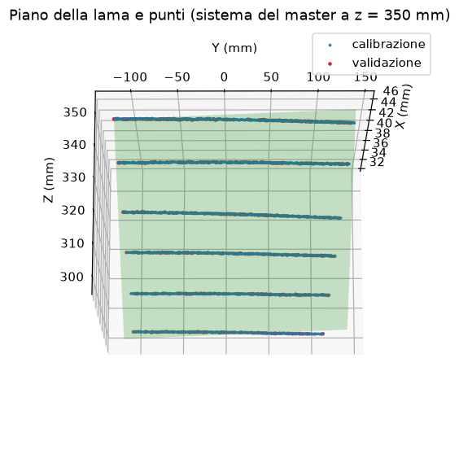
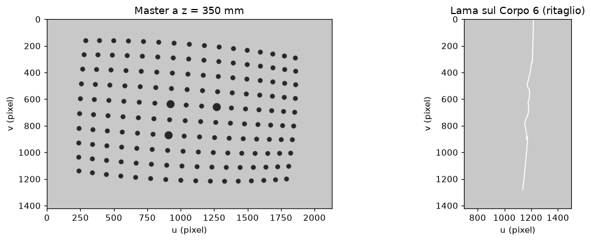

# Light Sheet 3D Scanner

A 3D scanner built from a camera and a laser light sheet, written from scratch in Python with NumPy and OpenCV. It calibrates the camera, calibrates the light plane, and measures the profile of 3D-printed solids in millimetres, with every step tested.

[](pyproject.toml)
[](LICENSE)



*Red: measured points. Dashed: nominal profile from the dimensions of the course drawings, aligned to the scan automatically. Plot labels are in Italian.*

Final project of the *3D Vision Systems* course (University of Brescia, 2024/25), rewritten as a package with unit tests, regressions on the real images and executed notebooks.

## Results

Two solids with known geometry, each measured from a single laser image taken in a lab with a setup that was not perfectly stable. The errors below are those of that setup.

| Quantity | Result |
|---|---|
| Distance of the points from the nominal profile (median / rms) | Corpo 6: 0.59 / 1.13 mm · Corpo 5: 0.68 / 1.09 mm |
| Peak heights, Corpo 6 (nominal 45 / 25 / 45 mm) | 44.3 / 23.9 / 44.5 mm, mean error −0.77 ± 0.21 mm |
| Peak heights, Corpo 5 (nominal 35 / 30 / 45 mm) | 34.8 / 29.6 / 45.5 mm, mean error −0.05 ± 0.38 mm |
| Flank inclination, Corpo 6 | within 3.8° of the drawing (measured 61.6°, 71.9°, 61.2°, 82.8°, 54.8° vs 60°, 70°, 65°, 80°, 55°) |
| Light plane, error on held-out points | 0.51 mm rms (10% of the points held out) |
| Camera, reprojection residual | median 1.7 px (about 0.4 mm on the master) |

> [!NOTE]
> Known limits, all visible in the plot above:
> - The right flank of the first peak of Corpo 6 cannot be measured: it is too steep to be lit by the sheet and seen by the camera.
> - On Corpo 5 the heights agree, but the central plateau sits about 3–4 mm to the left of the drawing. I have not established whether the cause is the printed part or the scan.
> - All three heights of Corpo 6 are low (−0.77 mm on average). The same code has no height bias on synthetic data (see below), so the cause is in the real setup or calibration, not in the peak estimator.
> - The camera views at z = 330 and 340 mm have much larger residuals (median 3–7 px) than the others (about 1–1.5 px). A richer per-view pose of the master (adding a height error and a rotation) brings them down to about 1 px, but it made the held-out profile error worse (about 0.5 mm to 0.8 mm), so it is not used. Views beyond the main master are left out of the fit because the setup moved between those shots.
> - The target view at z = 300 mm used to be dropped because OpenCV's default blob detector rejects the large circles of the "L" when the master is close to the camera. Now that it is detected and used, the median distance on the real scans is about 0.1 mm higher than without it. The synthetic data cannot say which of the two is right; the view is kept because dropping it was an accident of the detector.

## How it works



| 1. Camera | 2. Sheet centroid | 3. Light plane |
|---|---|---|
|  |  |  |
| The master is a grid of circles with three larger ones in an "L"; the corner is the origin. | The centroid of the sheet is taken on every image row. | The plane is fitted on the calibration points and validated on held-out ones. |

1. **Camera** ([notebook 1](notebooks/01_camera_calibration.ipynb)). One model (projection matrix, radial distortion and the master's lateral shift for each view) is fitted by least squares on all views. It works on points, not images, so distortion is never corrected twice.
2. **Light sheet** ([notebook 2](notebooks/02_light_plane_calibration.ipynb)). Each centroid is brought to object space by intersecting its ray with the plane at known `z`; the plane `z = Ax + By + C` is fitted by least squares and validated on held-out points and views.
3. **Measurement** ([notebook 3](notebooks/03_measurements.ipynb)). Every sheet pixel on a solid is triangulated with the camera and the plane; the profile is levelled on the support plane and peaks, heights and flank angles are extracted.

<details>
<summary>Camera calibration residuals</summary>


</details>

## Validation on synthetic data

Real images have no ground truth, so the measured error mixes the algorithm and the setup. `lightsheet3d.synthetic` renders images of a known scene (camera parameters taken from the real calibration, circle master, light sheet, a solid with its nominal profile) with the same names and format as the real ones; the pipeline reads them unchanged and the result is compared with the true geometry.




| Noise on the centres | Median distance from the true profile | 90th percentile |
|---|---|---|
| 0 px | 0.03 mm | 0.09 mm |
| 0.5 px | 0.18 mm | 0.74 mm |
| 1 px | 0.35 mm | 1.24 mm |
| 2 px | 0.64 mm | 1.98 mm |

The errors on the real images (0.6–0.7 mm median) are consistent with about 1–2 px of noise on the detected centres; I have not measured the real noise directly. With 2 px of noise the sheet produces spurious peaks of up to 10 mm on the support plane, so `measure_peaks` needs `prominence=10` instead of 6.

The synthetic data found four defects, each now covered by a test that fails without the fix:

- **Master drift in the camera fit.** The fit invented a linear drift of the master along z even when it did not move (a 0.25 mm systematic error with no noise). A linear drift in the offsets is indistinguishable from a small tilt of the axis in the projection matrix, so `fit_camera` now removes it.
- **Peak heights.** Sharp peaks were underestimated by about 0.5 mm, because the sheet has a thickness and the per-row centroid cuts the tip. `measure_peaks` now takes the intersection of the two flank lines, and the median of the points on a wide flat top. Over 8 seeds the bias goes from −0.52 mm to 0.00 mm without noise and from −0.44 mm to −0.01 mm at 0.5 px, with the same or lower rms.
- **Centroid of the sheet.** It used only the saturated core, with half a pixel of resolution; it is now weighted by the intensity on the soft edges (median error without noise from 0.10 to 0.03 mm).
- **Blob detector and profile alignment.** OpenCV's blob detector rejects circles above 5000 px², which dropped the large circles of the "L" when the master was close; and `align` could pick the mirrored profile with 2 px of noise because the vertical error was almost tied. It now decides with the distance in the (y, h) plane. The grid orientation is also fixed from the arms of the "L", since `findCirclesGrid` cannot tell a symmetric grid from its 180° rotation.

## Quick start

Requires [uv](https://docs.astral.sh/uv/) and Python 3.12 or later (developed on 3.15).

```bash
uv sync
uv run pytest        # about 30 s: includes the synthetic end-to-end tests and the regressions on the real images
```

The notebooks open with the project kernel (`ipykernel` is a dev dependency), for example from VS Code. JupyterLab is not included: `pyyaml` has no wheel for Python 3.15 yet.

From the raw images to the peaks of a solid:

```python
from lightsheet3d.measure import level_to_plate, measure_peaks
from lightsheet3d.pipeline import PLATE_Z, calibrate_camera, calibrate_light_plane, scan_points

camera = calibrate_camera("data/camera_calibration")
light = calibrate_light_plane("data/light_plane_calibration", camera.model)

X = scan_points("data/scans/30o34.jpg", camera.model, light.plane)  # (n, 3) points in mm
h = level_to_plate(X[:, 1], PLATE_Z - X[:, 2])                          # height above the support plane
for p in measure_peaks(X[:, 1], h, prominence=6):
    print(f"peak at y = {p.y:6.1f} mm, height {p.height:4.1f} mm")
```

## Nominal profiles

`lightsheet3d.solids` holds the profile of each solid, built step by step from the dimensions of the drawings (flank run = height / tan(inclination)). The top-view dimensions of Corpo 6 add up to 100.01 mm and those of Corpo 5 to 75.00 mm, and the tests check it. The scan frame is arbitrary, so `align` finds the shift and direction that put the nominal profile best on the measured points, and `distances` measures each point's distance to it in the (y, h) plane, which does not inflate errors on steep flanks.

> [!IMPORTANT]
> The assignment text and the drawings of the solids are course material (S. Dello Iacono, D. Solinas) and belong to their authors; they are not in this repository.

## Project layout

```
src/lightsheet3d/
  grid.py         circle grid and origin (corner of the "L")
  calibration.py  normalised DLT, radial distortion, joint model
  laser.py        sheet centroid per row
  lightplane.py   light plane and triangulation
  measure.py      profile levelling, heights and angles
  solids.py       nominal profiles, alignment and distance to the measured profile
  report.py       measured vs nominal plot
  synthetic.py    synthetic images with known geometry and an end-to-end evaluation
  pipeline.py     from raw images to measurements
tests/            unit tests, synthetic end-to-end tests and regressions on the real images
notebooks/        four notebooks with saved outputs (the fourth validates on synthetic data)
data/             raw images: camera_calibration, light_plane_calibration, scans
docs/figures/     figures produced by the notebooks
```

<details>
<summary>Italiano</summary>

Scanner 3D a triangolazione con telecamera e lama di luce, scritto da zero in Python con NumPy e OpenCV: calibrazione della camera, calibrazione del piano laser e misura in millimetri del profilo di solidi stampati in 3D. Progetto finale del corso *Sistemi di Visione 3D* (Università degli Studi di Brescia, A.A. 2024/25), riscritto come pacchetto testato.

- **Risultati**: distanza mediana dal profilo nominale 0,59 mm (Corpo 6) e 0,68 mm (Corpo 5); altezze dei picchi entro circa 1 mm; piano della lama 0,51 mm rms sui punti esclusi.
- **Validazione sintetica**: un generatore di immagini con geometria nota misura l'errore dell'algoritmo (0,03 mm mediani senza rumore, 0,64 mm con 2 px di rumore) e ha rivelato quattro difetti (deriva degli offset del master, altezza dei picchi sottostimata di 0,5 mm, baricentro della lama, rilevamento dei cerchi grandi e allineamento specchiato), tutti corretti e coperti da test.
- **Limiti**: il fianco destro del primo picco del Corpo 6 non è illuminabile; nel Corpo 5 il piano centrale è 3–4 mm a sinistra del disegno, causa non accertata; le tre altezze del Corpo 6 sono basse di 0,77 mm in media (non succede sui dati sintetici); le viste a z = 330 e 340 mm hanno residui alti (3–7 px).
- **Uso**: `uv sync` e `uv run pytest`; i notebook sono in [notebooks/](notebooks/).
- La traccia e i disegni dei solidi sono materiale del corso (S. Dello Iacono, D. Solinas) e non sono inclusi.

</details>
