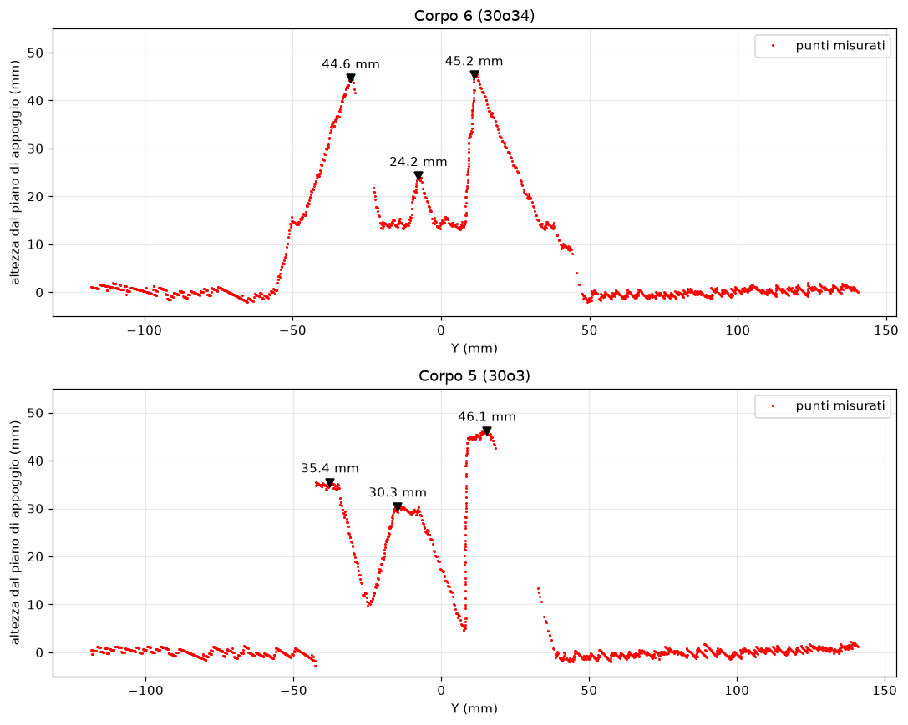
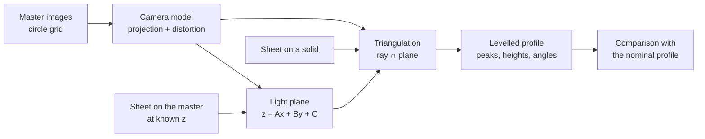
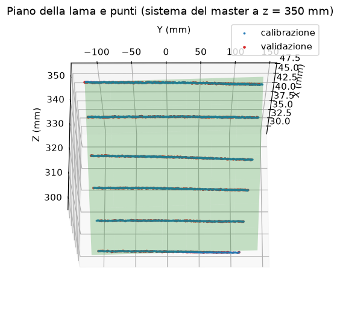
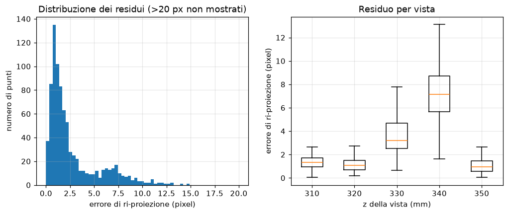

# Light Sheet 3D Scanner

A 3D scanner built from a camera and a laser light sheet, written from scratch in Python with NumPy and OpenCV. It calibrates the camera, calibrates the light plane, and measures the profile of 3D-printed solids in millimetres, with every step tested.

[](pyproject.toml)
[](LICENSE)



*Red: measured points. Dashed: nominal profile from the dimensions of the course drawings, aligned to the scan automatically. Plot labels are in Italian.*

Final project of the *3D Vision Systems* course (University of Brescia, 2024/25), rewritten as a package with unit tests, regressions on the real images and executed notebooks.

## Results

Two solids with known geometry, each measured from a single laser image taken in a lab with a setup that was not perfectly stable. The errors below are those of that setup.

| Quantity | Result |
|---|---|
| Distance of the points from the nominal profile (median / rms) | Corpo 6: 0.53 / 1.04 mm · Corpo 5: 0.69 / 1.14 mm |
| Peak heights, Corpo 6 (nominal 45 / 25 / 45 mm) | 44.6 / 24.2 / 45.2 mm, mean error −0.35 ± 0.42 mm |
| Peak heights, Corpo 5 (nominal 35 / 30 / 45 mm) | 35.4 / 30.3 / 46.1 mm, mean error +0.63 ± 0.36 mm |
| Flank inclination, Corpo 6 | within 5° of the drawing |
| Light plane, error on held-out points | 0.50 mm rms (10% of the points held out) |
| Camera, reprojection residual | median 1.6 px (about 0.4 mm on the master) |

> [!NOTE]
> Known limits, all visible in the plot above:
> - The right flank of the first peak of Corpo 6 cannot be measured: it is too steep to be lit by the sheet and seen by the camera.
> - On Corpo 5 the heights agree, but the central plateau sits about 3–4 mm to the left of the drawing. I have not established whether the cause is the printed part or the scan.
> - The camera views at z = 330 and 340 mm have much larger residuals (median 3–7 px) than the others (about 1–1.5 px); I have not investigated why. Views beyond the main master are left out of the fit because the setup moved between those shots.

## How it works



| 1. Camera | 2. Sheet centroid | 3. Light plane |
|---|---|---|
|  |  |  |
| The master is a grid of circles with three larger ones in an "L"; the corner is the origin. | The centroid of the sheet is taken on every image row. | The plane is fitted on the calibration points and validated on held-out ones. |

1. **Camera** ([notebook 1](notebooks/01_calibrazione_camera.ipynb)). One model (projection matrix, radial distortion and the master's lateral shift for each view) is fitted by least squares on all views. It works on points, not images, so distortion is never corrected twice.
2. **Light sheet** ([notebook 2](notebooks/02_lama_di_luce.ipynb)). Each centroid is brought to object space by intersecting its ray with the plane at known `z`; the plane `z = Ax + By + C` is fitted by least squares and validated on held-out points and views.
3. **Measurement** ([notebook 3](notebooks/03_misure.ipynb)). Every sheet pixel on a solid is triangulated with the camera and the plane; the profile is levelled on the support plane and peaks, heights and flank angles are extracted.

<details>
<summary>Camera calibration residuals</summary>



</details>

## Quick start

Requires [uv](https://docs.astral.sh/uv/) and Python 3.12 or later (developed on 3.15).

```bash
uv sync
uv run pytest        # about 20 s: includes the regressions on the real images
```

The notebooks open with the project kernel (`ipykernel` is a dev dependency), for example from VS Code. JupyterLab is not included: `pyyaml` has no wheel for Python 3.15 yet.

From the raw images to the peaks of a solid:

```python
from lightsheet3d.measure import level_to_plate, measure_peaks
from lightsheet3d.pipeline import PLATE_Z, calibrate_camera, calibrate_light_plane, scan_points

camera = calibrate_camera("images/target")
light = calibrate_light_plane("images/lama", camera.model)

X = scan_points("images/oggetto/30o34.jpg", camera.model, light.plane)  # (n, 3) points in mm
h = level_to_plate(X[:, 1], PLATE_Z - X[:, 2])                          # height above the support plane
for p in measure_peaks(X[:, 1], h, prominence=6):
    print(f"peak at y = {p.y:6.1f} mm, height {p.height:4.1f} mm")
```

## Nominal profiles

`lightsheet3d.solids` holds the profile of each solid, built step by step from the dimensions of the drawings (flank run = height / tan(inclination)). The top-view dimensions of Corpo 6 add up to 100.01 mm and those of Corpo 5 to 75.00 mm, and the tests check it. The scan frame is arbitrary, so `align` finds the shift and direction that put the nominal profile best on the measured points, and `distances` measures each point's distance to it in the (y, h) plane, which does not inflate errors on steep flanks.

> [!IMPORTANT]
> The assignment text and the drawings of the solids are course material (S. Dello Iacono, D. Solinas) and belong to their authors; they are not in this repository.

## Project layout

```
src/lightsheet3d/
  grid.py         circle grid and origin (corner of the "L")
  calibration.py  normalised DLT, radial distortion, joint model
  laser.py        sheet centroid per row
  lightplane.py   light plane and triangulation
  measure.py      profile levelling, heights and angles
  solids.py       nominal profiles, alignment and distance to the measured profile
  report.py       measured vs nominal plot
  pipeline.py     from raw images to measurements
tests/            synthetic unit tests and regressions on the real images
notebooks/        three notebooks with saved outputs
images/           raw images: target, sheet, object
docs/figures/     figures produced by the notebooks
```

<details>
<summary>Italiano</summary>

Scanner 3D a triangolazione con telecamera e lama di luce, scritto da zero in Python con NumPy e OpenCV: calibrazione della camera, calibrazione del piano laser e misura in millimetri del profilo di solidi stampati in 3D. Progetto finale del corso *Sistemi di Visione 3D* (Università degli Studi di Brescia, A.A. 2024/25), riscritto come pacchetto testato.

- **Risultati**: distanza mediana dal profilo nominale 0,53 mm (Corpo 6) e 0,69 mm (Corpo 5); altezze dei picchi entro circa 1 mm; piano della lama 0,50 mm rms sui punti esclusi.
- **Limiti**: il fianco destro del primo picco del Corpo 6 non è illuminabile; nel Corpo 5 il piano centrale è 3–4 mm a sinistra del disegno, causa non accertata; le viste a z = 330 e 340 mm hanno residui alti (3–7 px), causa non indagata.
- **Uso**: `uv sync` e `uv run pytest`; i notebook sono in [notebooks/](notebooks/).
- La traccia e i disegni dei solidi sono materiale del corso (S. Dello Iacono, D. Solinas) e non sono inclusi.

</details>
